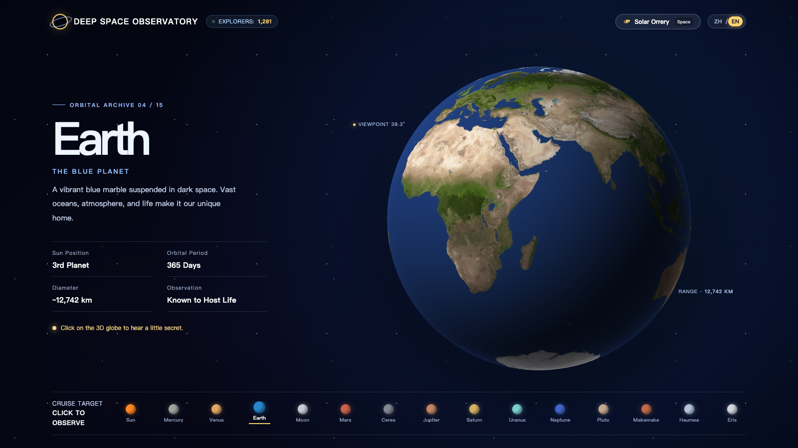
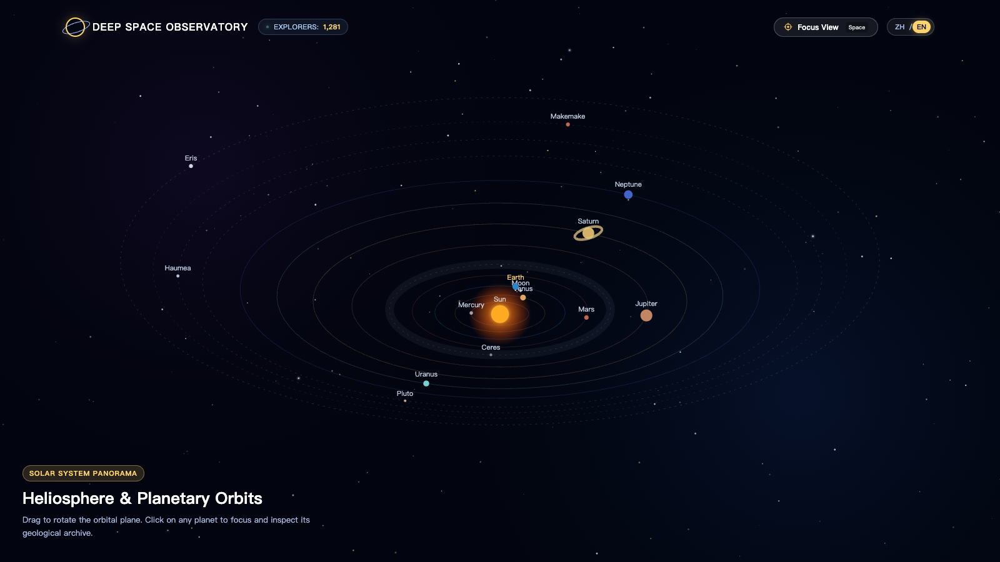

# Deep Space Observatory

**An interactive 3D solar system for curious kids. No install, no account, no setup — open the page and hold the solar system in your hands.**

[Launch the live site](https://sulongwooo.github.io/planet_observatory/) · [Run it locally](#run-it-locally)



---

## What you can do

- **Drag a planet** to inspect it from any angle, like holding a real planetary model.
- **Pick any of 15 bodies** from the bottom strip: the Sun, Mercury, Venus, Earth, the Moon, Mars, Ceres, Jupiter, Saturn, Uranus, Neptune, Pluto, Makemake, Haumea and Eris.
- **Press `Space`** to enter the solar-system panorama, where every orbit runs silently around the Sun. Drag to look down on the ecliptic plane; scroll to zoom in.
- **Click the globe** to hear the body tell you a little secret.
- **Press `T`** to switch between English and Chinese at any time.

## Two ways to explore

### Close-up observation

A high-resolution 3D globe fills the right side of the screen while its archive card — classification, orbital period, diameter and one memorable fact — sits on the left. Planets use real texture maps; a few dwarf planets use illustrative textures. Saturn's rings, Jupiter's Great Red Spot and Pluto's polar night are all rendered in place.

### Solar system panorama



The panorama is a procedurally drawn orrery, not a video. All 15 bodies move along their orbits, labels stay readable at any zoom, and clicking a planet jumps straight back to its close-up archive.

## Why it exists

Space is far away, and most planet lessons reduce a world to a name and a photo:

- **"How do the planets actually orbit the Sun?"** — the panorama turns an abstract diagram into a moving sky map you can rotate and zoom.
- **"What does a planet really look like?"** — each body is a 360° object you can drag, not a flat picture.
- **"Diameter and orbital period are boring."** — every archive card pairs the numbers with a short, kid-friendly spoken secret.

It is made for parents and teachers who want high-quality space content without ads, accounts, installers or a build step.

## Features

- WebGL close-up viewer with drag-to-rotate and smooth transitions between bodies
- Procedural solar-system panorama with click-to-focus navigation
- 15 archive cards with classification, orbital data, diameter and observation notes
- Saturn ring geometry, Jupiter's Great Red Spot and Pluto's polar-night shading
- Full English / Chinese interface, switchable at runtime
- Keyboard and pointer controls; responsive layout down to tablets
- Optional real visitor counter backed by a local SQLite database

## Controls

| Action | What it does |
| --- | --- |
| Click a body in the bottom strip | Switch the observation target |
| Drag the 3D globe | Rotate the viewpoint |
| Click the globe itself | Play the body's spoken secret |
| `Space` | Toggle close-up / solar-system panorama |
| `T` | Toggle English / Chinese |
| `←` / `→` | Previous / next body |

## Run it locally

### Option 1 — local server (recommended, with visitor statistics)

```bash
cd planet_observatory
python3 server.py
```

Open <http://localhost:8123>.

The server uses only the Python standard library. Visits are stored in `data/visits.db` (SQLite, git-ignored), and the header badge shows the real cumulative visitor count.

### Option 2 — just open the file

Double-click `index.html`. Everything works without a server; only the visitor counter falls back to a local, per-browser record.

## How the visitor counter works

- A visit is recorded once per browser/device per 24 hours; refreshing the page does not add another.
- A different browser or device is counted separately, so the number grows from real visits.
- The displayed value is `initial base + distinct visitors`. The base is `INITIAL_VISITORS` in `server.py` (default `1,280`), easy to change.
- Without the local server — for example on GitHub Pages — the badge shows the base plus the number of days this browser has visited. It never shows one hard-coded number for every visitor.

## Tech stack

- Native WebGL and Canvas 2D rendering
- No framework, no build step, no third-party runtime dependency
- One `index.html` holds all markup, styles and logic
- `server.py` (Python standard library + SQLite) provides local hosting and statistics

## Project structure

```
planet_observatory/
├── index.html              # Markup, styles and all client logic
├── server.py               # Local hosting + visitor statistics (SQLite)
├── assets/
│   ├── readme/             # README screenshots
│   └── textures/           # Texture maps for 15 bodies and the star field
└── data/                   # Local visit database (created at runtime, git-ignored)
```

## License

MIT License © 2026
